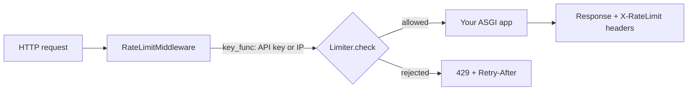

# rate-limiter-lab

Four rate-limiting algorithms behind one interface, an ASGI middleware that plugs them into FastAPI or Starlette, and a benchmark that shows where each one bends.

No runtime dependencies. Python 3.10+.

## Why this exists

"Add rate limiting" hides a real design choice. The four common algorithms trade memory, accuracy and burst behaviour differently, and the differences only show under adversarial traffic. This repo implements all four the same way so they can be compared directly.

## The algorithms

| Algorithm | Memory per key | Behaviour |
|---|---|---|
| `FixedWindow` | 1 counter | Simplest. A client that bursts around a window boundary gets up to 2x the limit. |
| `SlidingWindowLog` | 1 timestamp per request | Exact. Costs O(limit) memory per key. |
| `SlidingWindowCounter` | 2 counters | Blends the previous and current window. Near-exact at fixed-window cost. |
| `TokenBucket` | 2 numbers | Allows a burst up to capacity, then holds the average to the refill rate. |

## Benchmark

`python -m bench.run`, limit of 100 requests per 60 s. The client is adversarial: every minute it fires 150 requests in the last 2 s of the window and 150 in the first 2 s of the next. Numbers below are from one run on a shared cloud container; throughput will differ on your machine, the admitted counts will not.

| Algorithm | Checks / second | Most admitted in any 60 s | Over limit |
|---|---:|---:|---:|
| Fixed window | 706,501 | 200 | 100% |
| Sliding window log | 726,211 | 100 | 0% |
| Sliding window counter | 668,521 | 104 | 4% |
| Token bucket | 932,268 | 107 | 7% |

Reading it:

- Fixed window lets the attacker double the limit, as the theory predicts.
- The sliding log is exact.
- The sliding counter is off by 4% because it assumes the previous window's requests were evenly spread, and here they were packed into its last 2 s.
- The token bucket admits its full capacity plus whatever refills during the span. That is by design, not a bug: it bounds the average rate, not every 60 s span.

## Design



- **One contract.** Every limiter implements `check(key, cost) -> Decision`. A `Decision` carries `allowed`, `remaining`, `retry_after` and `reset_after`.
- **Atomic per key.** Each key has its own lock, so one busy client never blocks another. A test runs 16 threads against one key and asserts exactly `limit` requests pass.
- **Honest `Retry-After`.** A test checks, for all four algorithms, that waiting exactly `retry_after` seconds is enough for the next request to succeed.
- **Injectable clock.** Tests use a fake clock, so nothing sleeps and nothing is flaky.
- **Weighted requests.** `check(key, cost=5)` charges an expensive endpoint more.

## Use it

```python
from fastapi import FastAPI
from ratelimit import RateLimitMiddleware, TokenBucket
from ratelimit.middleware import header_key

app = FastAPI()
app.add_middleware(
    RateLimitMiddleware,
    limiter=TokenBucket(capacity=20, rate=5),   # burst of 20, then 5 per second
    key_func=header_key("x-api-key"),          # falls back to client IP
    exempt_paths=("/health",),
)
```

## Run it

```bash
pip install -e ".[dev]"
pytest -q                 # 18 tests
python -m bench.run       # the table above

pip install -e ".[demo]"
uvicorn example_app:app   # or: docker build -t rate-limiter-lab . && docker run -p 8000:8000 rate-limiter-lab
```

## Limits of this implementation

State lives in process memory, so limits are per process. Running several API replicas needs shared state, typically Redis with a Lua script to keep the check atomic. The `Limiter` protocol is the seam for that; a Redis backend is the natural next step. There is also no eviction of idle keys yet.
